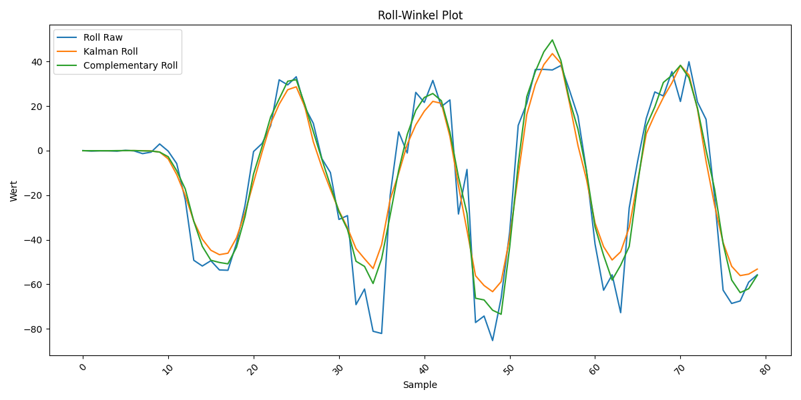
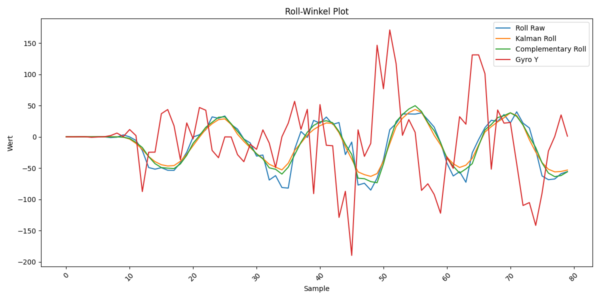
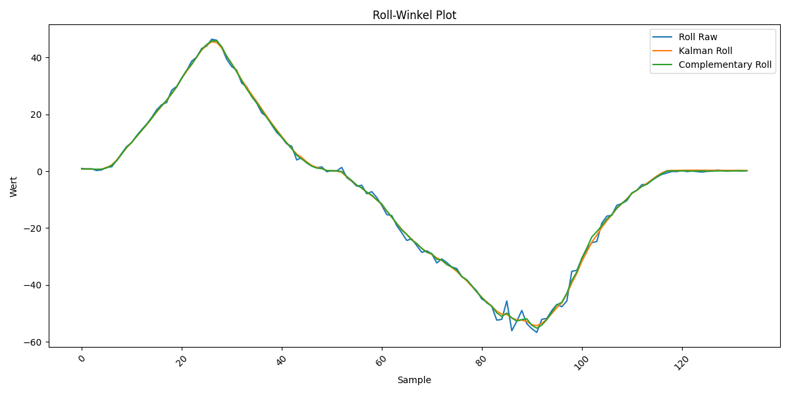
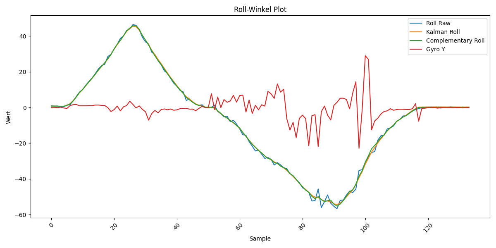
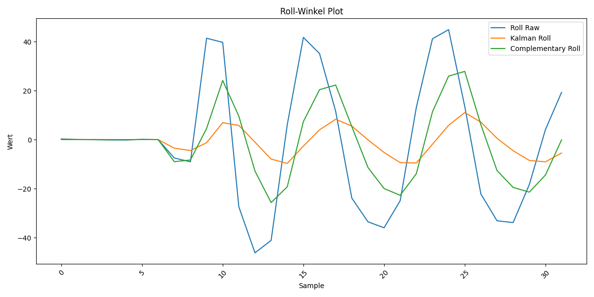
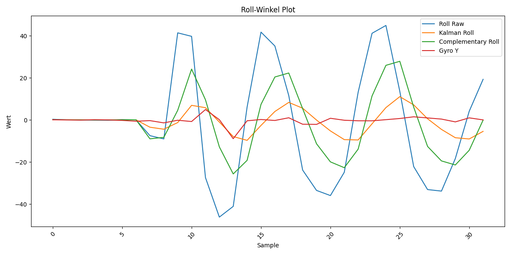
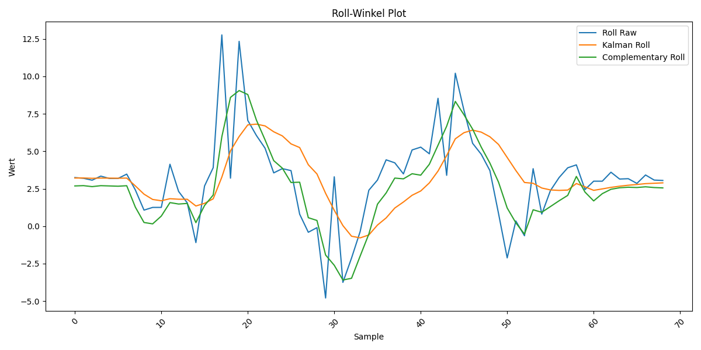

# Quadcopter-Fernbedienung: Lagebestimmung mit Sensordatenfusion (ESP32 + MPU6050)

Laborprojekt im Modul **Sensortechnik** (Studiengang Informations- und Kommunikationstechnik).

Ein Quadcopter wird über eine selbst entwickelte, ESP32-basierte Fernbedienung gesteuert, zunächst per **Joystick**, dann durch **Kippen und Neigen der Fernbedienung selbst**. Für die Lagebestimmung kommt eine Multisensorsignalverarbeitung (Beschleunigungssensor + Gyroskop) zum Einsatz. Der Joystick-Taster startet und landet den Quadcopter, ein **Not-Aus** schaltet die Motoren sofort ab.

## Inhalt

- [Systemaufbau](#systemaufbau)
- [Hardware und Schaltplan](#hardware-und-schaltplan)
- [Verfahren zur Lagebestimmung](#verfahren-zur-lagebestimmung)
- [Software](#software)
- [Durchführung](#durchführung)
- [Ergebnisse](#ergebnisse)
- [Fazit und Ausblick](#fazit-und-ausblick)

## Systemaufbau

Der Aufbau aus dem vorherigen Laborinkrement (Betriebszustandsmonitoring) wird wiederverwendet:


- Die Fernbedienung (**ESP32**) ist per **USB** mit dem Computer verbunden.
- Auf dem ESP32 läuft ein Arduino-Programm, das die Messdaten an den Computer weiterleitet.
- Auf dem Computer läuft ein **Python-Skript**, das die Daten auswertet und den Quadcopter per **WLAN** steuert.

## Hardware und Schaltplan


| Komponente | Anschluss am ESP32 |
|---|---|
| MPU6050 (I²C) | SDA → G21, SCL → G22, Versorgung 5 V und GND |
| Joystick | X → G32, Y → G33 (ADC-Messung), Taster → G25, Versorgung 3,3 V und GND |
| Not-Aus-Taster | G26 und GND |

Der MPU6050 liefert Beschleunigungs- und Drehratendaten. Die Joystick-Achsen werden per ADC gemessen, die beiden Taster digital eingelesen.

## Verfahren zur Lagebestimmung

Drei Verfahren werden verglichen:

1. **Winkel über den Schwerkraft-Vektor** (nur Beschleunigungssensor, im Folgenden „Roll Raw“)
2. **Komplementärfilter**
3. **Kalman-Filter**

### Komplementärfilter

Der Beschleunigungssensor liefert langzeitstabile Winkel, ist aber empfindlich gegenüber dynamischen Beschleunigungen. Das Gyroskop misst Winkelgeschwindigkeiten, driftet aber nach der Integration. Der Komplementärfilter kombiniert beide gewichtet:

$$\theta(t) = \alpha \left(\theta(t-1) + \dot{\theta}_\text{Gyro} \cdot \Delta t\right) + (1-\alpha)\cdot\theta_\text{Accel}$$

Dabei ist $\alpha$ der Filterkoeffizient, der das Verhältnis zwischen integrierten Gyroskopdaten und Beschleunigungsdaten festlegt.

### Kalman-Filter

Der Kalman-Filter ist ein rekursiver Schätzer, der in zwei Schritten arbeitet.

**Prädiktion:**

$$\hat{x}(t|t-1) = A\,\hat{x}(t-1|t-1) + B\,u(t), \qquad P(t|t-1) = A\,P(t-1|t-1)\,A^T + Q$$

**Korrektur:**

$$K(t) = P(t|t-1)\,H^T\left(H\,P(t|t-1)\,H^T + R\right)^{-1}$$

$$\hat{x}(t|t) = \hat{x}(t|t-1) + K(t)\left(z(t) - H\,\hat{x}(t|t-1)\right), \qquad P(t|t) = \left(I - K(t)\,H\right)P(t|t-1)$$

Mit Zustandsschätzung $\hat{x}$, Kovarianzmatrix $P$, Kalman-Gewinn $K$, Prozessrauschkovarianz $Q$ und Messrauschkovarianz $R$.

## Software

**ESP32 (Arduino)**
- liest Joystick-Achsen und beide Taster aus
- ruft die Messdaten des MPU6050 ab
- berechnet die Lage nach allen drei Verfahren
- überträgt die Daten per USB an den Computer

**Python-Skript (PC)**
- stellt die Verbindung zum Quadcopter her und liest periodisch die Daten des ESP32
- das Steuerverfahren (Schwerkraft-Vektor, Komplementärfilter, Kalman-Filter) ist einstellbar
- sendet über das Kommando `rc` Eingaben, die denen einer normalen Fernbedienung entsprechen
- skaliert die Werte so, dass **45° Neigung der Fernbedienung** einer vollen Auslenkung entsprechen
- Joystick-Taster: Starten bzw. Landen; Not-Aus-Taster: Motoren sofort aus

## Durchführung

1. PC per WLAN mit dem Quadcopter verbinden und das Python-Skript starten.
2. Fernbedienung per USB an den Computer anschließen.
3. Quadcopter starten und nacheinander mit den verschiedenen Methoden steuern, zusätzlich den Not-Aus testen.
4. Messreihen aufzeichnen: Fernbedienung auf der Roll-Achse erst **langsam**, dann **schnell** neigen, außerdem eine kurze Reihe mit **schneller Translationsbewegung**.

## Ergebnisse

Dargestellt ist jeweils der Roll-Winkel als Rohwert (Roll Raw), nach Kalman-Filter und nach Komplementärfilter, teilweise mit der Gyroskop-Y-Achse.

### Schnelle Neigung

| Ohne Gyroskop | Mit Gyroskop (Y-Achse) |
|---|---|
|  |  |

Die Rohdaten schwanken stark und sind für eine direkte Steuerung ungeeignet. Beide Filter glätten das Signal deutlich. Der Kalman-Filter folgt plötzlichen Änderungen etwas genauer, der Komplementärfilter reagiert gleichmäßig und stabil.

### Langsame Neigung

| Ohne Gyroskop | Mit Gyroskop (Y-Achse) |
|---|---|
|  |  |

Bei langsamer Bewegung liegen alle drei Kurven eng beieinander. Die Rohdaten zeigen nur kleine Störungen, die beide Filter glätten.

### Schnelle Querbewegung (Translation)

| Ohne Gyroskop | Mit Gyroskop (Y-Achse) |
|---|---|
|  |  |

Bei reiner Translation fälscht die dynamische Beschleunigung den aus dem Schwerkraft-Vektor berechneten Winkel stark. Beide Filter dämpfen diese Störung, der Kalman-Filter dabei am stärksten.

### Langsame Querbewegung (Translation)



### Zusammenfassung

- Die Rohdaten sind verrauscht und anfällig für dynamische Beschleunigungen.
- Beide Filter verbessern die Signalqualität deutlich und kompensieren Rauschen und Drift.
- Der Kalman-Filter liefert die beste Schätzung, der Komplementärfilter ist die einfachere, aber ebenfalls wirksame Lösung.
- Die Filter glätten auf Kosten einer leichten Verzögerung bei schnellen Änderungen.

## Fazit und Ausblick

Die Steuerung des Quadcopters per Joystick und per Neigung der Fernbedienung funktioniert. Start, Landung und Not-Aus arbeiteten zuverlässig. Mögliche nächste Schritte:

- Feinabstimmung der Filterparameter
- Verbesserungen der Sensordatenfusion
- Integration zusätzlicher Sensoren
- Constant-Velocity-Modell für den Kalman-Filter weiter ausarbeiten

## Projektstruktur (Vorschlag)

```
.
├── README.md
└── images/
    ├── blockdia_drawio.png
    ├── Schaltplan_drawio.png
    ├── tilt_fast.png
    ├── tilt_fast_incl_gyro.png
    ├── tilt_slow.png
    ├── tilt_slow_incl_gyro.png
    ├── transl_fast.png
    ├── transl_fast_incl_gyro.png
    └── transl_slow.png
```
